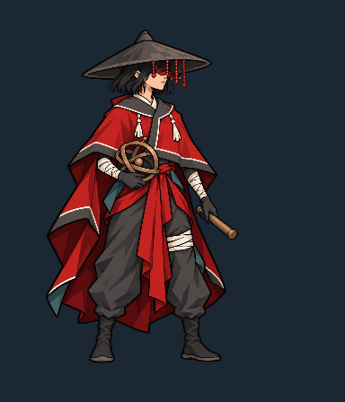

# 天相者 TianXiang

《杀戮尖塔2》独立角色模组，最终整理版本 **v0.6.0**。目标游戏版本 **0.111.0**，依赖 RitsuLib **0.6.10**。

## 下载与安装

前往 [Releases](https://github.com/3264762673-source/TianXiang/releases/tag/v0.6.0) 下载 Windows/macOS 安装包。退出游戏后解压；Windows 运行 `安装到游戏.cmd`，macOS 在终端运行 `bash Install-macOS.command`。首次安装在游戏中启用天相者与 RitsuLib 并重启。详细步骤见 [使用说明](docs/使用说明.txt)。

## 内容

- 90 张卡牌，阴阳与水、尘、风组成观天体系，小型改天消耗体系。
- 专属药水、3 个专属遗物、色彩哲学家和部分事件适配。
- 红灰服饰角色、横版卡图、骨骼烘焙的 27 帧攻击动画。
- 安装包包含可选的独立随机天气挑战模组。

[卡表](docs/卡表90张.csv) · [文件校验](SHA256SUMS.txt)

## 开发文件

`src/` 包含角色、天气挑战和 QA 源码。Release 的 `TianXiang-v0.6.0-source-art.zip` 包含对应原始资源，解压后将各项目 resources 合并到 src 下相应项目。编译需 .NET 9、合法安装的游戏及 RitsuLib，按 csproj 中的 GameDir、RitsuDir 配置本地路径。资源需要用 Godot 导入后打包，源代码并非无需配置的一键构建环境。

## 验证范围

Windows 隔离游戏环境通过 19 项集成断言，并验证外职业卡牌与色彩哲学家接入。macOS 安装脚本通过语法及模拟目录测试，尚未进行真实 Mac 游戏运行验证。未宣称所有事件或高层平衡均已完整测试。

本仓库不包含游戏本体。安装包内第三方 RitsuLib 保留其 LICENSE；其他游戏相关权利归各自权利人。PPT 不包含在本次发布中。
